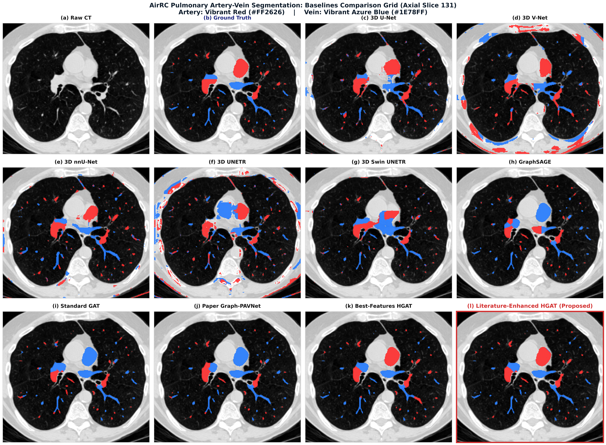
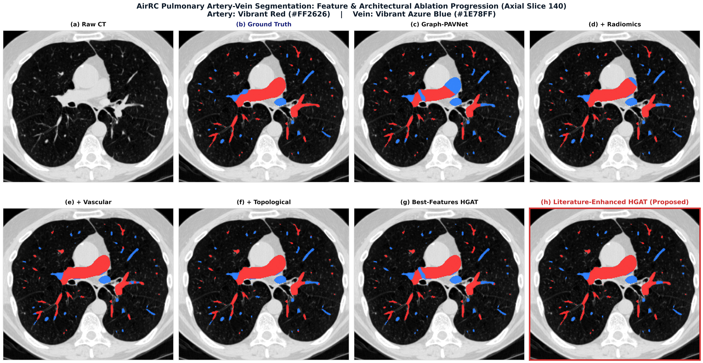

# Enhanced Graph-PAVNet: Pulmonary Artery-Vein Separation

An enhanced hierarchical graph neural network framework for pulmonary artery-vein separation in thoracic CT. Built upon **Graph-PAVNet**, this project incorporates an **18-feature domain-specific anatomical extension** (584d to 602d), a **3-branch decoupled cross-gating adapter**, and a **multi-objective loss formulation** to resolve thin vessel feature degradation, multimodal feature interference, and parallel companion artery-vein crossover errors.

Evaluated across three clinical thoracic CT benchmarks: **AirRC** (254 scans), **HiPaS 2025** (250 scans), and **Lung250M-4B** (248 paired scans).

---

## 📖 Baseline Narrative: Graph-PAVNet & Motivation

Our methodology builds upon the seminal framework **Graph-PAVNet** (*Li et al., Key Research Laboratory of Intelligent Computing of Medical Images, Northeastern University, Shenyang, China*):
- **Core Paradigm**: Instead of memory-intensive 3D dense voxel grids, Graph-PAVNet models the pulmonary vascular tree as a spatial graph over medial-axis centerlines, using a 3-hop Hierarchical Graph Attention Network (HGAT) to propagate contextual labels from the cardiac hilum outward.
- **Node Feature Representation (584d)**: Graph-PAVNet samples 576-dimensional visual patch tokens using a frozen 3D Vision Transformer (ViT) patch encoder from 16x16x16 voxel sub-volumes, combined with 8-dimensional coordinate and orientation features.

### Limitations of Baseline Graph-PAVNet
While Graph-PAVNet addressed structural fragmentation present in traditional CNNs, critical failure modes remain:
1. **Distal Feature Degradation**: The 576-dim visual ViT patch tokens degrade in small peripheral vessels (radius <= 1.5 mm / BV5 biomarker), where CT partial volume effects and low contrast dominate.
2. **Naive Feature Concatenation**: Graph-PAVNet concatenates raw coordinates and ViT visual features directly without adaptive cross-modal weighting.
3. **Artery-Vein Crossover Confusion**: In crowded lobar planes where parallel companion artery-vein bundles travel side-by-side, basic node-level cross-entropy loss produces frequent false label switching.

---

## 🔬 Our Proposed Extensions: Enhanced HGAT

To resolve these bottlenecks, we introduce three core technical enhancements:

```
                               ┌──────────────────────────────────────────────────────────┐
                               │                    Raw Input Node Features               │
                               │  - Visual ViT Stream (576d)                              │
                               │  - Radiomic Textures (LoG vesselness, HU gradients)      │
                               │  - Geometric Morphometry (coords, caliber, Murray flow)  │
                               └────────────────────────────┬─────────────────────────────┘
                                                            │
                               ┌────────────────────────────▼─────────────────────────────┐
                               │     3-Branch Decoupled Cross-Gating Adapter (256d)       │
                               │  - Master query: local vascular caliber (r_i)            │
                               │  - High caliber (trunks)   --> Emphasizes visual ViT     │
                               │  - Low caliber (periphery) --> Emphasizes geom + radiomics│
                               └────────────────────────────┬─────────────────────────────┘
                                                            │
                               ┌────────────────────────────▼─────────────────────────────┐
                               │      Hierarchical Graph Attention Backbone (3 Hops)      │
                               │  - Direction-guided k-NN message passing (k=10)          │
                               │  - BFS hierarchy hop gating from cardiac hilum seeds     │
                               └────────────────────────────┬─────────────────────────────┘
                                                            │
                               ┌────────────────────────────▼─────────────────────────────┐
                               │                     Dual Output Heads                    │
                               │  1. Primary Classifier Head: Log-Softmax PA / PV Logits  │
                               │  2. Auxiliary Caliber Head: Continuous Diameter Radius r │
                               └────────────────────────────┬─────────────────────────────┘
                                                            │
                               ┌────────────────────────────▼─────────────────────────────┐
                               │             Multi-Objective Loss Formulation             │
                               │  L_total = (1-w_s)L_focal + w_s L_seed + w_cldice L_cldice│
                               │            + w_thick L_thick + w_fpr L_fpr               │
                               └──────────────────────────────────────────────────────────┘
```

1. **Domain-Specific Anatomical Feature Extension (584d to 602d)**:
   - Evaluated 20 candidate features and identified the **18 Optimal Descriptors**:
     - *Vascular Morphometry (7d)*: local caliber radius, caliber tapering rate, relative neighbor caliber ratio, craniocaudal orientation, branching alignment dispersion, distance to hilum centroid, and Murray's law cubic flow residual.
     - *Multi-Scale Radiomics (8d)*: raw CT attenuation HU, local 5x5 mean/std, 3D Sobel intensity gradients, multi-scale Laplacian of Gaussian tubular vesselness (fine, medium, coarse), and center-to-parenchymal shell contrast.
     - *High-Impact Literature Descriptors (3d)*: scale-invariant normalized caliber (*MorVess*), topological Gaussian radial decay (*Topo-UNet*), and intramural attenuation Z-contrast gradient (*MorVess*).
2. **3-Branch Decoupled Cross-Gating Fusion Adapter**:
   - Decouples input representations into three dedicated semantic projections: Visual ViT (256d), Radiomic Textures (128d), and Geometric Morphometry (128d).
   - Caliber-conditioned gating balances visual features in central trunks with geometric continuity in distal peripheral vessels.
3. **Multi-Objective Topological & Caliber Loss Formulation**:
   - **Graph Centerline Continuity Loss (clDice)**: Enforces smooth cosine probability continuity across same-class skeleton edges (adapted from Shit et al., CVPR 2021).
   - **Auxiliary Caliber Regression Head (Caliber Loss)**: Smooth L1 diameter supervision preserves natural proximal-to-distal vascular tapering (adapted from MorVess).
   - **Artery-Vein FPR Crossover Penalty (FPR Loss)**: Suppresses label flipping in parallel companion vascular bundles (adapted from Topo-UNet).
   - **Radius-Weighted Focal Loss**: Directly prioritizes thin peripheral vessels (BV5 clinical focus).
4. **Spatial Landmark Skeleton Graph (8,192 Nodes)**:
   - Constructs 3D spatial graphs over distance-weighted landmark point clouds via spatial k-NN (k=3, bidirectional), naturally robust to local partial-volume breaks.

---

## 📂 Repository Directory Navigator

| Directory / File | Description | Key Modules |
| :--- | :--- | :--- |
| [`configs/`](configs/) | Dataset & baseline experiment YAML configurations | [`airrc.yaml`](configs/airrc.yaml), [`hipas.yaml`](configs/hipas.yaml), [`lung250m.yaml`](configs/lung250m.yaml), [`baselines/`](configs/baselines/) |
| [`data/`](data/) | Dataset specifications, split manifests, and I/O loaders | [`README.md`](data/README.md), [`splits/`](data/splits/), [`loaders/`](data/loaders/) |
| [`src/models/`](src/models/) | Enhanced HGAT, Graph-PAVNet baseline, PyG & MONAI models | [`enhanced_hgat.py`](src/models/enhanced_hgat.py), [`baseline_hgat.py`](src/models/baseline_hgat.py), [`gnn_baselines.py`](src/models/gnn_baselines.py), [`volumetric_baselines.py`](src/models/volumetric_baselines.py) |
| [`src/features/`](src/features/) | 18 optimal feature extraction library | [`morphometry.py`](src/features/morphometry.py), [`radiomics.py`](src/features/radiomics.py), [`topology.py`](src/features/topology.py), [`extractor.py`](src/features/extractor.py) |
| [`src/losses/`](src/losses/) | Multi-objective topological and caliber losses | [`focal_dice.py`](src/losses/focal_dice.py), [`cldice_graph.py`](src/losses/cldice_graph.py), [`multi_task_loss.py`](src/losses/multi_task_loss.py) |
| [`src/evaluation/`](src/evaluation/) | 7 standardized metrics & COPD clinical imaging biomarkers | [`metrics.py`](src/evaluation/metrics.py), [`biomarkers.py`](src/evaluation/biomarkers.py), [`postprocessing.py`](src/evaluation/postprocessing.py) |
| [`src/utils/`](src/utils/) | Medial-axis skeletonization, k-NN graph builder, visualizer | [`graph_builder.py`](src/utils/graph_builder.py), [`visualization.py`](src/utils/visualization.py) |
| [`scripts/`](scripts/) | High-level CLI entry points for GPU training & evaluation | [`train.py`](scripts/train.py), [`evaluate.py`](scripts/evaluate.py), [`extract_features.py`](scripts/extract_features.py), [`run_ablations.py`](scripts/run_ablations.py), [`compute_feature_importance.py`](scripts/compute_feature_importance.py) |
| [`checkpoints/`](checkpoints/) | Model weights downloader and instructions | [`README.md`](checkpoints/README.md), [`download_checkpoints.py`](checkpoints/download_checkpoints.py) |
| [`docs/`](docs/) | Benchmark tables, feature descriptions, high-res prediction grids, and report | [`BENCHMARKS.md`](docs/BENCHMARKS.md), [`ABLATION_DETAILS.md`](docs/ABLATION_DETAILS.md), [`figures/`](docs/figures/), [`reports/`](docs/reports/) |

---

## 📊 Benchmark Highlights

Models are benchmarked across 3 clinical thoracic CT datasets against 8 canonical baselines (Dense 3D U-Net, V-Net, nnU-Net, UNETR, Swin UNETR, Standard GAT, GraphSAGE, and baseline Graph-PAVNet) across all 7 standardized metrics: Accuracy, Precision, Recall, Specificity, Dice (DSC), mIoU, and physical HD95 (mm).

| Dataset | Graph-PAVNet Baseline | Enhanced HGAT (Proposed) | Dice Gain | HD95 Improvement | Detailed Tables |
| :--- | :---: | :---: | :---: | :---: | :---: |
| **AirRC** *(39 Test Scans)* | 0.7388 | **0.7780** | **+3.92%** | **12.80 -> 12.05 mm** | [View AirRC Benchmark](docs/BENCHMARKS.md#1-airrc-thoracic-ct-benchmark-held-out-test-split-39-scans) |
| **HiPaS 2025** *(37 Test Scans)* | 0.7600 | **0.8212** | **+6.12%** | **16.48 -> 11.74 mm** | [View HiPaS Benchmark](docs/BENCHMARKS.md#2-hipas-2025-thoracic-ct-benchmark-held-out-test-split-37-scans) |
| **Lung250M-4B** *(30 Test Scans)* | 0.6851 | **0.7373** *(0.7414 Ext.)* | **+5.22%** | **14.19 -> 13.05 mm** | [View Lung250M Benchmark](docs/BENCHMARKS.md#3-lung250m-4b-thoracic-ct-benchmark-held-out-test-split-30-paired-scans) |

> 📖 **Full Benchmark Reports**: Complete results for all 8 baselines, class-specific breakdowns (PA vs. PV), and respiratory inspiration/expiration dynamics are documented in [`docs/BENCHMARKS.md`](docs/BENCHMARKS.md).  
> 🧪 **Ablation Studies**: Complete feature descriptions, category-wise ablation steps (584d -> 592d -> 599d -> 604d -> 602d), and Permutation Feature Importance (PFI) rankings are detailed in [`docs/ABLATION_DETAILS.md`](docs/ABLATION_DETAILS.md).  
> 📄 **Comprehensive Research Report (PDF)**: The full mentor research report with detailed benchmark comparisons, background literature, and high-resolution qualitative prediction grids is available directly in PDF format at [`docs/reports/Pulmonary_Artery_Vein_Separation_Report.pdf`](docs/reports/Pulmonary_Artery_Vein_Separation_Report.pdf) (also provided in [Word format](docs/reports/Pulmonary_Artery_Vein_Separation_Report.docx)).

---

## 🖼️ Qualitative Predictions Showcase

### Figure 1: Baseline Architecture Comparison (AirRC Slice 131)

*(a) Raw CT, (b) Ground Truth, (c) 3D U-Net, (d) 3D V-Net, (e) 3D nnU-Net, (f) 3D UNETR, (g) 3D Swin UNETR, (h) Standard GraphSAGE, (i) Standard GAT, (j) Baseline Graph-PAVNet, (k) Best-Features HGAT, (l) Enhanced HGAT (Proposed).*

### Figure 2: Feature & Architectural Ablation Progression (AirRC Axial Slice 140)

*(a) Raw CT, (b) Ground Truth, (c) Graph-PAVNet (Baseline 584d), (d) + Radiomics (592d), (e) + Vascular Geometry (599d), (f) + Topological (604d), (g) Best-Features HGAT (602d), (h) Enhanced HGAT (Proposed, 602d).*

---

## 🚀 Quickstart

### 1. Environment Setup
```bash
conda env create -f environment.yml
conda activate pulmonary_pav
pip install -e .
```

### 2. Checkpoint Downloads
Fetch pre-trained model weights into `checkpoints/`:
```bash
python checkpoints/download_checkpoints.py --all
```
> **Note**: Pre-trained model weights are currently placeholders and will soon be uploaded to Hugging Face upon paper publication. You can train all models directly from scratch (Step 3) or place locally trained weights into `checkpoints/`.

### 3. GPU Training
Train Enhanced HGAT for 50 epochs on NVIDIA GPU:
```bash
# AirRC
python scripts/train.py --config configs/airrc.yaml --model enhanced_hgat --epochs 50 --device cuda:0

# HiPaS 2025
python scripts/train.py --config configs/hipas.yaml --model enhanced_hgat --epochs 50 --device cuda:0

# Lung250M-4B
python scripts/train.py --config configs/lung250m.yaml --model enhanced_hgat --epochs 50 --device cuda:0
```

### 4. Benchmark Evaluation
Evaluate trained checkpoints on held-out test splits across all 7 metrics:
```bash
python scripts/evaluate.py --config configs/airrc.yaml --dataset airrc --checkpoint checkpoints/airrc_enhanced_hgat_602.pth
```

---

## 📚 Publications & Citations

### Foundational Baseline Paper
- **Graph-PAVNet**: Qingya Li, Ye Yuan, Lu Liu, Nan Bao, Lisheng Xu, Wenjun Tan. *Graph-PAVNet: A Graph-Based Learning Framework for Pulmonary Artery and Vein Separation Using Multimodal Feature Sampling.* Key Research Laboratory of Intelligent Computing of Medical Images, Northeastern University, China. [GitHub Repository](https://github.com/Lqy1018/Graph-PAVNet).

### Benchmark Clinical Datasets
- **AirRC**: Liu, J., Zhang, Z., Niu, B. et al. *A Custom Annotated Dataset for Segmentation of Pulmonary Veins, Arteries, and Airways.* Scientific Data 12, 1806 (2025). [https://doi.org/10.1038/s41597-025-06074-6](https://doi.org/10.1038/s41597-025-06074-6)
- **HiPaS 2025**: Chu, Y., Luo, G., Zhou, L. et al. *Deep learning-driven pulmonary artery and vein segmentation reveals demography-associated vasculature anatomical differences.* Nature Communications 16, 2262 (2025). [https://doi.org/10.1038/s41467-025-56505-6](https://doi.org/10.1038/s41467-025-56505-6)
- **Lung250M-4B**: Falta, F., Großbröhmer, C., Hering, A., Bigalke, A., Heinrich, M. *Lung250M-4B: A Combined 3D Dataset for CT- and Point Cloud-Based Intra-Patient Lung Registration.* Advances in Neural Information Processing Systems 36 (NeurIPS 2023) Datasets and Benchmarks Track. DOI: [10.52202/075280-2392](https://doi.org/10.52202/075280-2392)

---

## 📜 License
This project is released under the [MIT License](LICENSE).
